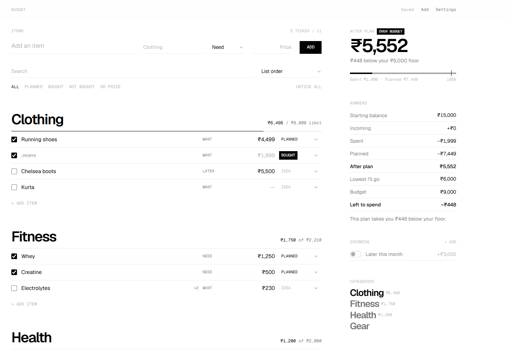

# Budget

**A minimal, monochrome budget planner.** List what you want to buy, put a price on it, tick it, and see exactly where your balance lands against the lowest you're willing to let it go.



- **Plan before you spend.** Tick items to see your balance drop in real time; mark them *Bought* when the money actually goes.
- **A floor, not just a budget.** Set the lowest your balance should ever reach; the app tells you how far above or below it your plan leaves you.
- **Yours to shape.** Categories with optional limits, priorities, incoming money, currency and number style, light/dark theme, density.
- **Private by default.** No accounts, no tracking. Data lives in a JSON file on your machine, or in your browser when hosted statically.
- **Fast and quiet.** Black on white, one typeface family, no animations, about 93 KB of gzipped JavaScript.

---

## Quick start

Requires **Node.js 22.18 or newer** ([nodejs.org](https://nodejs.org)).

On Windows, double-click **`start.bat`**: it installs dependencies the first time, then opens http://127.0.0.1:5050. Keep its window open while you use the app.

Elsewhere:

```bash
npm install
npm run build && npm run serve    # http://127.0.0.1:5050
```

For working on the code, `npm start` runs the Vite dev server with hot reload on the same port (don't run both at once).

## Using it

| To | Do this |
| --- | --- |
| Add an item | Type in the top bar: name, category, priority, price, then **Enter**. A new category name creates that category. |
| Add to a category | **+ Add item** under any category. |
| Plan it | Tick the checkbox. *After plan* drops by its price. |
| Mark it bought | Click its status (*Idea → Planned → Bought*). |
| Edit anything | Click the name or price in the row. **Enter** in a price jumps to the next one. |
| Reorder | Drag the ⋮⋮ handle, within a category or into another one (empty categories included). Keyboard: focus the handle, **Space**, arrow keys, **Space**. Works while sorting by *List order*. |
| Delete | The bin icon at the end of the row. Undo from the message that appears. |
| More options | The chevron opens quantity, category, priority, status, note and link. |
| Set your balance | Click *Starting balance* or *Lowest I'll go* in the right column. |
| Jump to a category | Click its name in the right column. |

Price fields accept numbers only. Grouping is added for you (`15000` shows as `₹15,000`).

### How the numbers work

```
After plan     = starting balance + counted income − spent − planned
Budget         = starting balance + counted income − lowest I'll go      (or a fixed amount)
Left to spend  = budget − spent − planned
```

The plan is marked **Tight** when less than 15% of the budget is left (adjustable), and **Over budget** when you go past the budget or below your floor.

### Settings

| Tab | What you can change |
| --- | --- |
| Money | Plan name, balance, floor, budget mode (everything above floor or a fixed amount), *tight* threshold, currency symbol, number style (Indian, international, European), decimals |
| Income | Money you're expecting, with a switch for whether it counts yet |
| Categories | Rename, reorder, per-category spending limits, delete (items move to another category) |
| Priorities | Rename, reorder (used by *Sort → Priority*), add, delete |
| Display | Light / dark / system theme, comfortable or compact rows |
| Data | Export a backup (.json), import one, export items (.csv), start over |

---

## Where your data lives

| Running as | Saved to | Shared across devices |
| --- | --- | --- |
| `start.bat` / `npm run serve` (local) | `data.json` in the project folder, plus a safety copy in the browser | Yes, with your other devices over Tailscale (see DEPLOY.md) |
| `npm run serve` on a server | `data.json` in `DATA_DIR`, plus a safety copy in the browser | Yes, for anyone with the password |
| A static host (Vercel, Netlify, …) | This browser only | No. Use *Export / Import* to move it |

**Nothing you type is lost if the server stops.** Every change is written to the browser first, then to `data.json` a moment later. If the server isn't running (say you closed the `start.bat` window), a black banner says so, changes wait in the browser, and they're written to `data.json` as soon as the server is back: either straight away in the same tab, or the next time you open the app ("Recovered").

- **Backups:** every save also updates `backups/data-YYYY-MM-DD.json`, one per day, last 30 days. To roll back, stop the app and copy one over `data.json`.
- **Not on GitHub:** `data.json`, `data.*.json` and `backups/` are git-ignored, so pushing code never uploads your numbers. Back up the project folder (or use *Export backup*) if you want a copy elsewhere.
- **Several devices:** each device picks up the others' changes when you return to it (and every 15 s). If two devices save at once, the second sees *"Changed on another device"* with a **Use mine** option, so nothing is overwritten silently.
- Older files (including the first version's format) are upgraded and validated automatically on load and on import.

### Moving to a database later (Vercel)

The app only ever talks to one endpoint: `GET /api/data` returns the plan as JSON (or `null`), and `PUT /api/data` replaces it. Locally that's `server/data-api.ts` writing `data.json`. To deploy on Vercel with a database, add a Vercel Function at `api/data.ts` that implements the same two methods against your database (Neon Postgres, Supabase, Upstash Redis… one JSON row/key is enough), protect it with a password or Vercel's auth, and deploy. The front end needs no changes: when `/api/data` answers with JSON it uses it, and it keeps the browser safety copy either way. Export a backup from the local app and import it after deploying to bring your data across.

## Deploy

**Step-by-step guide: [DEPLOY.md](DEPLOY.md).** In short:

| | Public (optional) | Private |
| --- | --- | --- |
| For | Anyone who wants to use the app | Just you, on your laptop, phone and any device you approve |
| How | A normal Vercel deployment | Your laptop runs the app; your devices reach it over [Tailscale](https://tailscale.com) (free), or an always-on server with a password |
| Data | In each browser; move it with Export/Import | One `data.json`, synced automatically |
| Who sees it | Each visitor sees only their own copy | Only devices signed into your account |

The production server (`npm run serve`) takes `PORT`, `HOST`, `DATA_DIR`, `BUDGET_PASSWORD` and `OPEN_BROWSER`. It refuses to listen on a public interface without a password, and serves `/healthz` for uptime checks.

---

## Development

| Script | |
| --- | --- |
| `npm start` | Dev server, opens the browser |
| `npm run dev` | Dev server without opening a browser |
| `npm test` | Unit tests (Vitest) |
| `npm run typecheck` | TypeScript, no output |
| `npm run build` | Typecheck and production build into `dist/` |
| `npm run serve` | Production server for `dist/` (see *Deploy*) |
| `npm run check` | Typecheck, tests and build: what CI runs |

GitHub Actions runs `typecheck`, `test` and `build` on every push and pull request ([`.github/workflows/ci.yml`](.github/workflows/ci.yml)).

### Project structure

```
server/
  data-api.ts        GET/PUT /api/data ↔ data.json (used by the dev server and serve.ts)
  serve.ts           production server: static files, data API, password, health check
src/
  types.ts           the data model
  store/budget.ts    zustand store, actions, debounced auto-save
  store/ui.ts        view state (search, open panels)
  lib/calc.ts        all budget maths
  lib/money.ts       currency formatting and the numbers-only input parser
  lib/migrate.ts     upgrades and validates saved or imported data
  lib/api.ts         storage: data server, or browser storage on static hosts
  lib/reorder.ts     drag-and-drop moves
  components/list/      add bar, category sections, item rows
  components/summary/   right-hand numbers column
  components/settings/  settings panel tabs
  index.css          theme: one ink colour at three strengths
seed.json            the blank starting plan
render.yaml          Render blueprint
```

### Adding a setting

1. Add the field to `Settings` or `Display` in `src/types.ts`, and a default in `seed.json`.
2. Validate it in `normalizeSettings` / `normalizeDisplay` in `src/lib/migrate.ts`, so older files get the default.
3. Read it with `useData((d) => d.settings.yourField)` and add a control in `src/components/settings/`.

### Stack

React 19, TypeScript, Vite, Tailwind CSS 4, zustand, dnd-kit, Geist and Geist Mono (bundled locally), lucide icons, Vitest.
